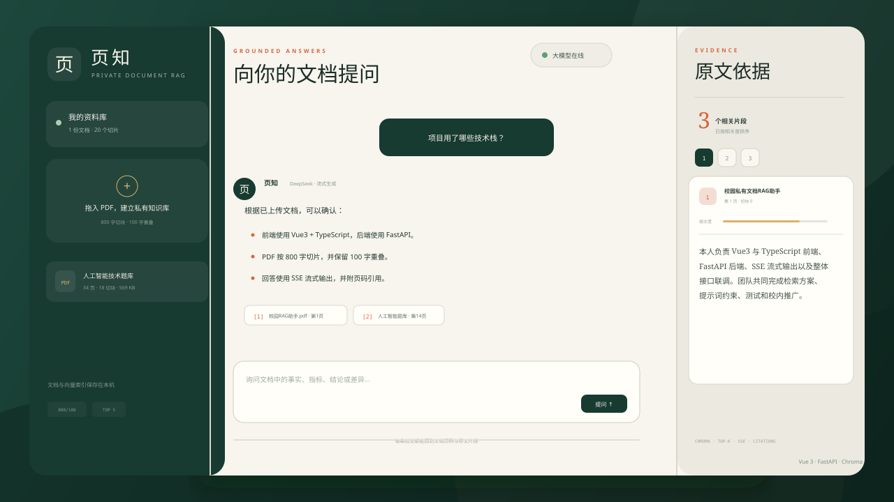

# 页知 · 私有文档 RAG 问答助手

根据项目介绍复刻的可运行全栈版本。上传本地 PDF 后，文档会按 800 字切块、保留 100 字重叠并写入 Chroma；提问时召回 Top-K 片段，通过 SSE 流式返回带来源编号和页码的回答。



## 功能

- Vue 3 + TypeScript 文档问答界面
- FastAPI 异步后端与标准 OpenAPI 文档
- PDF 文本提取、页码追踪、切片和分段摘要
- Chroma 持久化向量索引
- Top-K 检索、去重、轻量重排与上下文预算控制
- SSE 流式输出、首字延迟统计、停止生成
- 引用来源侧栏、页码、相关度和原文片段
- 多文档选择、上传任务进度和文档删除
- 离线摘录模式：没有大模型密钥也能完整跑通
- OpenAI 兼容接口支持：配置后启用真正的生成式回答

## 一键运行

双击 `启动页知.cmd`，浏览器会打开：

```text
http://127.0.0.1:8010
```

第一次运行会检查 `.venv`。依赖已安装时约 2 秒启动。

可上传自带的 PDF。仓库提供生成演示文档的脚本：

```powershell
uv run python scripts/create_sample_pdf.py
```

生成文件位于 `samples/校园私有文档RAG助手.pdf`。

## 使用在线大模型

复制 `.env.example` 为 `.env`：

```powershell
Copy-Item .env.example .env
```

填入任意 OpenAI 兼容服务：

```dotenv
RAG_API_KEY=your-key
RAG_BASE_URL=https://api.openai.com/v1
RAG_MODEL=gpt-4.1-mini
```

例如使用 DeepSeek：

```dotenv
RAG_API_KEY=your-deepseek-key
RAG_BASE_URL=https://api.deepseek.com/v1
RAG_MODEL=deepseek-chat
```

未配置密钥时，系统仍会进行真实检索，并从命中片段中摘录原文回答。两种模式都会输出引用。

## 开发模式

后端：

```powershell
uv sync
uv run uvicorn backend.app.main:app --reload --host 127.0.0.1 --port 8010
```

前端：

```powershell
cd frontend
npm install
npm run dev
```

前端地址为 `http://127.0.0.1:5173`，Vite 会将 `/api` 代理到 `8010`。

## 生产构建

```powershell
cd frontend
npm run build
```

构建完成后，FastAPI 会自动提供 `frontend/dist`，因此只需启动后端即可访问完整页面。

## 测试

```powershell
uv run pytest -q
```

测试覆盖样例 PDF 上传、异步索引、Chroma 写入、检索、SSE 事件、引用与文档删除。

## 接口

| 方法 | 路径 | 用途 |
| --- | --- | --- |
| GET | `/api/health` | 服务、模型、索引状态 |
| GET | `/api/documents` | 文档列表 |
| POST | `/api/documents/upload` | 上传 PDF 并创建索引任务 |
| GET | `/api/jobs/{job_id}` | 查询切块与索引进度 |
| DELETE | `/api/documents/{id}` | 删除文档及向量 |
| POST | `/api/chat/stream` | SSE 检索与流式回答 |

完整接口文档：`http://127.0.0.1:8010/docs`

## 目录

```text
backend/app/
  main.py                 FastAPI 路由与 SSE
  config.py               参数与模型配置
  db.py                   文档、任务元数据
  services/pdf_ingest.py  PDF 提取、切块、摘要
  services/embeddings.py  离线确定性向量
  services/vector_store.py Chroma 及备用索引
  services/rag.py         检索、上下文、流式回答
frontend/src/             Vue 3 前端
samples/                  演示 PDF
data/                     上传文件、SQLite 与 Chroma 索引
```

## 当前限制

- 仅支持有文本层的 PDF；扫描版需要先 OCR。
- 默认离线向量使用确定性哈希，适合演示和稳定启动；生产环境可替换为 BGE、E5 或商用 embedding。
- 在线模型必须遵守 Prompt 中的引用要求，但最终事实仍应由使用者核对原文。
- 当前为单用户本地版本，尚未加入登录、团队权限和审计日志。
